<div align="center">


# CROSSFIT **RECORDS**

**A private personal-records tracker for a group of friends.**
Log every lift and benchmark, watch your progress, and see who is leading the board.

[](https://github.com/Avivlevi01/crossfit-records/actions/workflows/ci.yml)


<br>

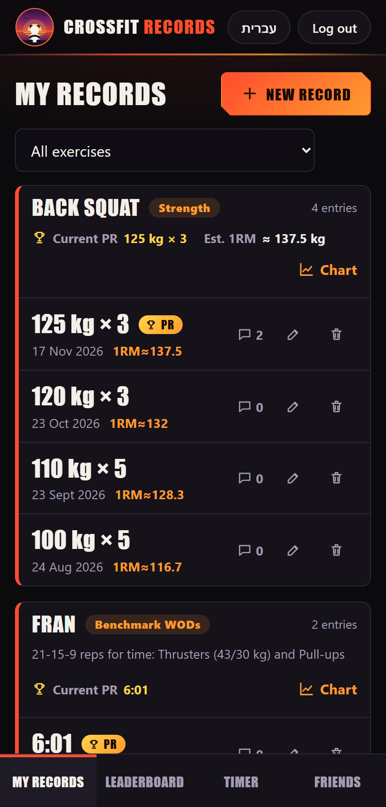
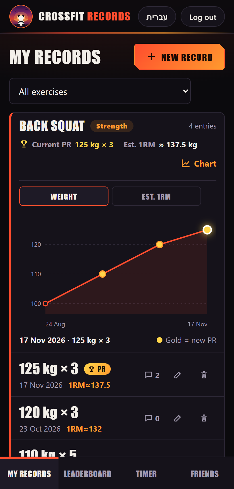
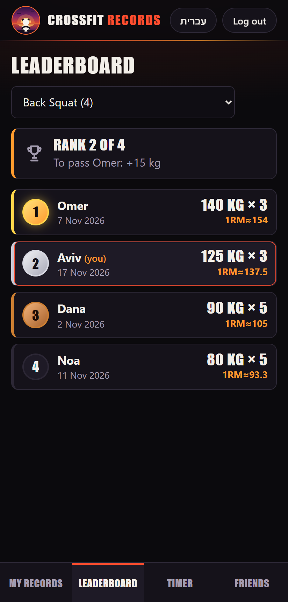
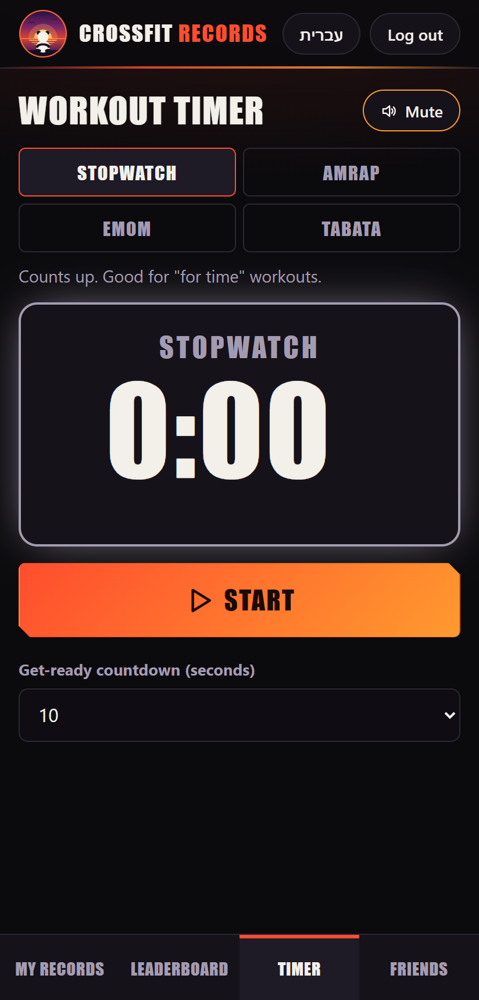
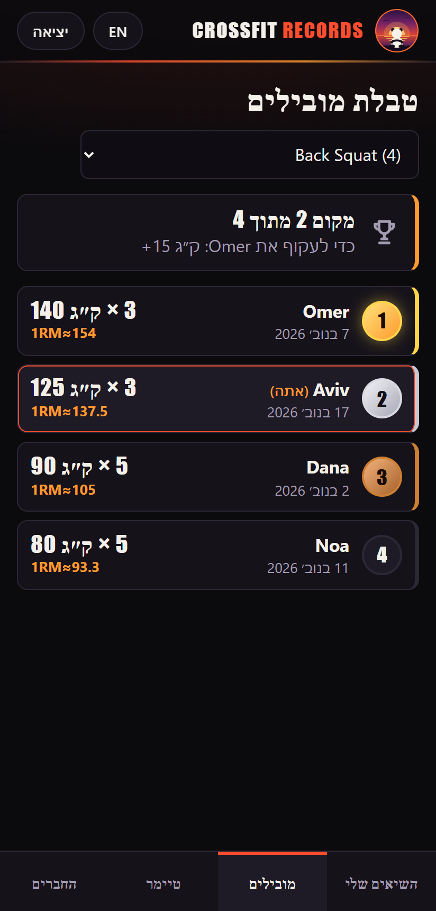

<sub>Demo data. The app is mobile-first, dark, and fully bilingual (English / Hebrew with right-to-left layout).</sub>

</div>

---

## ✨ What it does

| | |
|---|---|
| 🏋️ **Log records** | Weight × reps, reps only, time (Fran, Murph...) or distance + time. 38 default exercises, and you can add your own. |
| 📈 **Progress charts** | Every attempt is kept. The chart shows the trend and marks new personal records in gold. |
| 🧮 **Estimated 1RM** | Calculated from weight and reps (Epley formula), so a 3-rep set can be compared with a 5-rep set. |
| 🏆 **Leaderboard** | Per exercise, with your rank and how much you need to pass the next person. |
| 💬 **Comments** | Friends can react to a record. Only the owner can edit or delete their own records. |
| ⏱️ **Workout timer** | Stopwatch, AMRAP, EMOM and Tabata, with sound and a get-ready countdown. |
| 🎉 **PR celebration** | A short celebration when you beat your previous best. |
| 🔒 **Invite-only** | Registration needs a shared invite code. Passwords are hashed with Argon2. |

<details>
<summary><b>More screens</b></summary>
<br>
<div align="center">
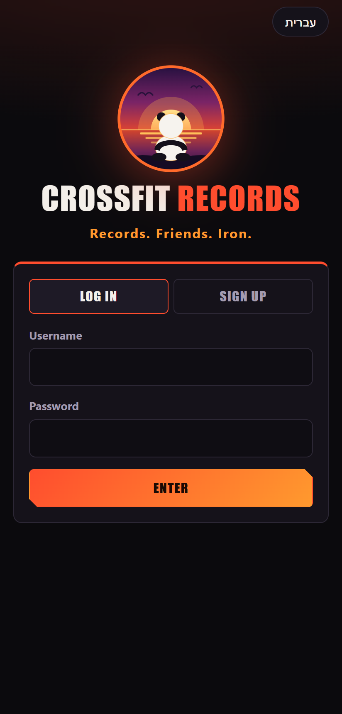
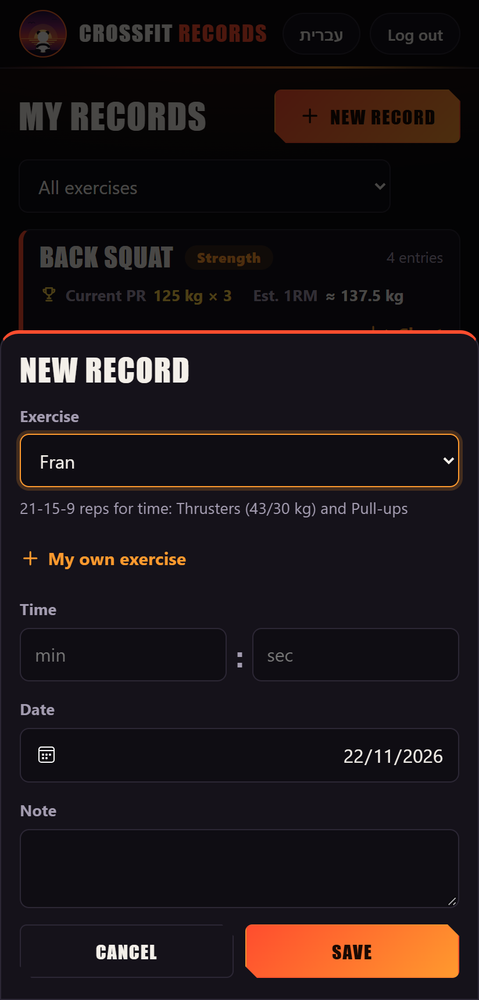
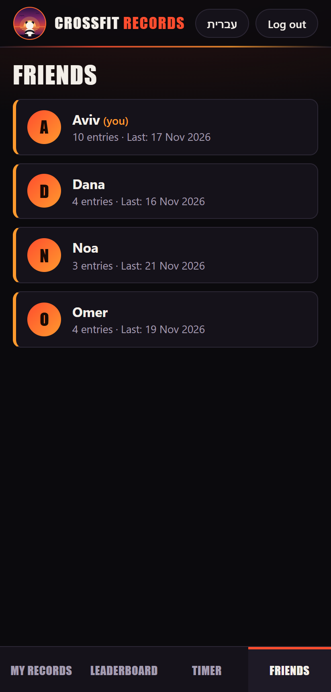
</div>
</details>

---

## 🤖 Automated quality checks (CI)

<div align="center">


<sub>Illustration of the pipeline. The live result is the <b>CI</b> badge at the top of this page.</sub>

</div>

GitHub starts a **clean machine** and checks the whole project on every push to `main`, on every pull request, and **every night** (03:17 UTC). The steps run in order and the first failure stops the run.

| Station | What runs | What it catches |
|---|---|---|
| 📤 **Push** | The workflow in [`ci.yml`](.github/workflows/ci.yml) starts | |
| 🧱 **Setup** | Fresh Ubuntu, PostgreSQL 17, Python 3.13 and the dependencies | "Works only on my computer" problems |
| 🔍 **Lint** | `ruff check .` | Real mistakes, risky patterns, messy imports |
| 🧪 **Tests** | 63 `pytest` tests against a real database | Broken permissions, validation, login limits and PR logic |
| ⏱️ **Timer** | 15 JavaScript tests (Node 22) | Wrong phases, sounds or clock formatting in the workout timer |

<details>
<summary><b>Why it is built this way</b></summary>
<br>

- **Lint before tests:** it needs no database, so the cheapest failure shows up first.
- **A real PostgreSQL, not a substitute:** the same major version as local development.
- **Made-up settings in the workflow:** the database is thrown away after each run, and no real secret is in the repository.
- **A nightly run:** it can reveal breakage from a new library release even when nobody changed the code.
- **What it does not do:** Cloud Build deploys on its own, so a red run is a warning and does not block a release. The browser screens have no automated tests.

</details>

---

## 🏗️ Architecture

The app is deliberately simple: **one container** that serves both the API and the front-end, talking to **one PostgreSQL database**. Everything else (HTTPS, scaling, deploys) is handled by the platform.

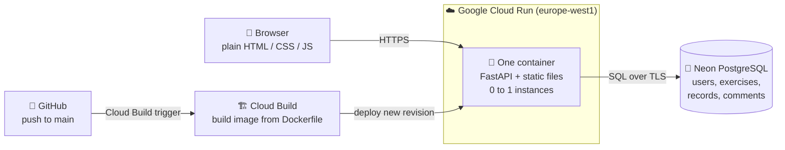

### Why it is built this way

| Decision | Why | What we gave up |
|---|---|---|
| **FastAPI + Pydantic** | Types become validation and automatic API docs. Small and fast to write. | Fewer batteries than Django. |
| **Plain HTML/CSS/JS (no framework, no build step)** | Nothing to compile, tiny payload, and the whole front-end is readable in an afternoon. | More manual DOM code. |
| **PostgreSQL, not SQLite** | Real constraints and concurrent writers, and the same engine locally and in production. | A separate service to run. |
| **Database apart from the app** | The container is stateless and can be replaced or restarted at any time. Only the database holds data. | One more thing to secure and back up. |
| **Docker (multi-stage)** | Identical environment on a laptop and in the cloud. The production image runs as a non-root user. | Needs Docker to develop. |
| **Cloud Run + Neon** | Scales to zero, so a hobby app costs close to nothing. HTTPS is included. | A cold start of a few seconds after idle. Free tiers can change. |
| **Push to deploy** | Every push to `main` builds and releases by itself. | The tests run in a separate pipeline that does not block the release. |

### Data model

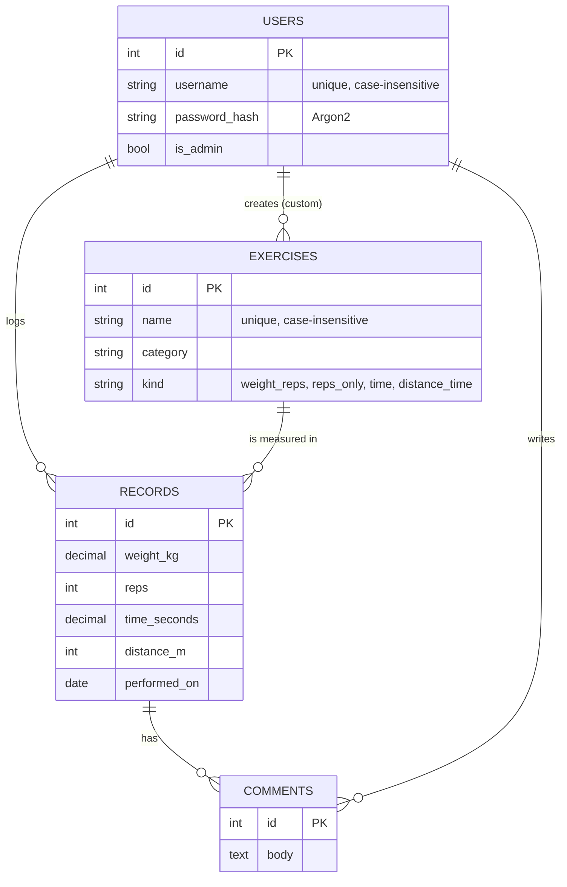

`kind` decides which fields of a record are used, so one table handles squats, pull-ups, Fran and a 5K run. Database `CHECK` constraints back up the API validation.

### What happens when you save a record

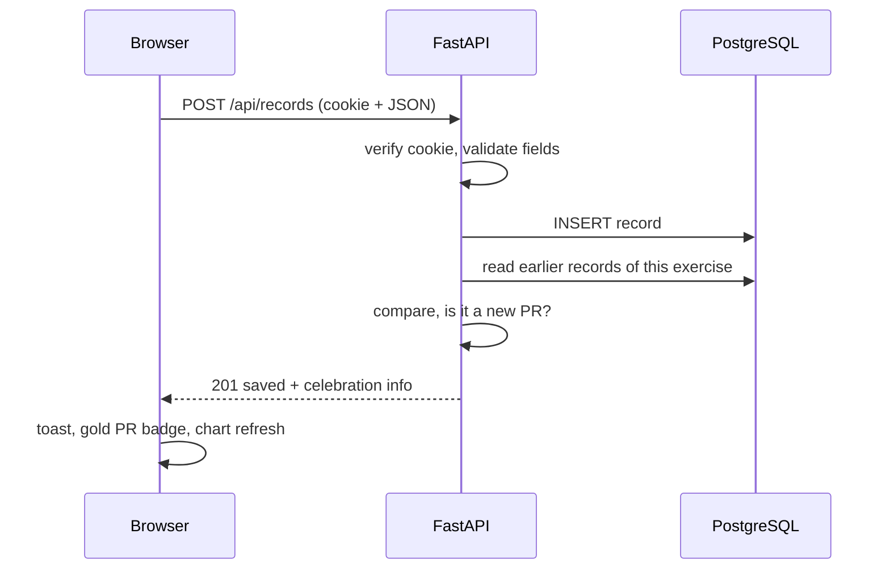

### Security in short

- **Passwords**: hashed with Argon2, never stored in plain text. A password change invalidates old sessions (the cookie carries a fingerprint of the hash).
- **Session**: JWT in an `httpOnly`, `SameSite=Lax` cookie (`Secure` in production), so scripts on the page cannot read it.
- **Brute force**: wrong passwords and wrong invite codes are rate-limited per client IP (and per username for logins). The limiter is in memory, which fits a single instance. Behind a proxy the real IP is the Nth entry from the **right** of `X-Forwarded-For` (`TRUSTED_PROXY_HOPS`), because the left side can be forged.
- **Headers**: strict CSP (`default-src 'self'`), HSTS, `X-Frame-Options`, `nosniff`, and `no-store` on API responses.
- **Authorization**: any logged-in user may read; only the owner may change their own records. Covered by tests.
- **Secrets** (database URL, signing key, invite code) live only in the platform's environment settings, never in the repo.

---

## 🚀 Run it locally

Requires **Docker Desktop**.

```bash
cp .env.example .env          # edit the values (a dev .env is fine locally)
docker compose up --build
```

| | |
|---|---|
| App | http://localhost:8000 |
| API docs (development only, `ENABLE_DOCS=true`) | http://localhost:8000/docs |
| Health check | http://localhost:8000/api/health |

Migrations run automatically on start (`alembic upgrade head`) and the default exercises are seeded. Friends register with the `INVITE_CODE` from `.env`.

## ✅ Tests

```bash
docker compose run --rm app pytest -q          # API: permissions, validation, login limits, PR logic
node --test "tests/js/*.test.mjs"              # timer logic (Node 22+, nothing to install)
docker compose run --rm --build app ruff check .  # lint (settings in ruff.toml)
```

The same checks run automatically, see [Automated quality checks](#-automated-quality-checks-ci).

## ☁️ Deployment

The live setup is **Google Cloud Run + Neon**, deployed by a Cloud Build trigger on every push to `main`. The container reads `$PORT`, rewrites Neon's `postgresql://` URL for the driver, and runs migrations on start.

Alternative: a single VPS with `docker-compose.prod.yml` (app + PostgreSQL + Caddy with automatic HTTPS). Step by step in [DEPLOY.md](DEPLOY.md) (Hebrew).

### Backups

```bash
./scripts/backup-neon.sh                                  # writes backups/neon-<date>.sql.gz
./scripts/restore-neon.sh backups/neon-<date>.sql.gz      # replaces the target database
```

Docker is the only requirement. The connection string is typed hidden (or passed through `NEON_DATABASE_URL`) and never written to disk. For the VPS stack use `scripts/backup.sh` / `restore.sh`.

## 🧰 Owner commands

```bash
docker compose exec app python -m app.admin list-users
docker compose exec app python -m app.admin set-password <username>   # reset a forgotten password
```

## 🗄️ Changing the database

After editing `app/models.py`:

```bash
docker compose run --rm app alembic revision --autogenerate -m "describe the change"
docker compose up -d --force-recreate app     # applies it
```

## 📁 Project layout

```
app/            FastAPI code
  main.py         app factory, security headers, static files
  models.py       SQLAlchemy models
  schemas.py      Pydantic request/response models
  security.py     password hashing, JWT cookie
  ratelimit.py    login/invite limiter, client-IP logic
  pr.py           personal-record and 1RM logic
  routers/        auth, exercises, records + comments, leaderboard
alembic/        database migrations
static/         front-end: index.html, css/, js/ (i18n, chart, timer...), logo.svg
tests/          pytest API tests + Node timer tests
.github/        CI workflow (GitHub Actions)
ruff.toml       lint settings
scripts/        backup / restore (VPS and Neon)
docs/           README screenshots and the CI animation
```

---

<details>
<summary><b>🇮🇱 תקציר בעברית</b></summary>
<br>

<div dir="rtl">

**שיאים בקרוספיט** הוא אתר פרטי לחברים: רושמים שיאים (משקל, חזרות, זמן, מרחק), רואים גרף התקדמות, טבלת דירוג לכל תרגיל, תגובות וטיימר אימון. הממשק בעברית ובאנגלית, מותאם לטלפון.

**ארכיטקטורה:** קונטיינר אחד (FastAPI שמגיש גם את ה-API וגם את הדפים) שמדבר עם מסד PostgreSQL אחד. האתר רץ ב-Google Cloud Run, המסד ב-Neon, וכל `push` ל-`main` בונה ומעלה גרסה חדשה לבד. ההרשמה בקוד הזמנה, והסיסמאות נשמרות מוצפנות (Argon2).

**בדיקות אוטומטיות:** בכל העלאה ל-`main` ובכל לילה, GitHub בודק את הקוד עם `ruff` ומריץ את כל הבדיקות.

**הרצה מקומית:** `docker compose up --build`, ואז http://localhost:8000. **גיבוי:** `./scripts/backup-neon.sh`. מדריך העלאה מפורט ב-[DEPLOY.md](DEPLOY.md).

</div>

</details>
